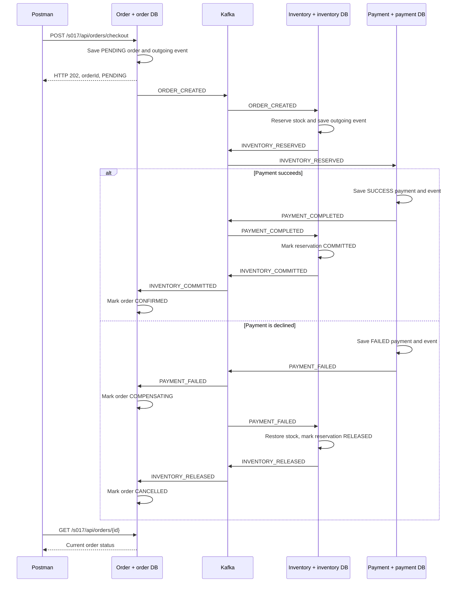

# Distributed transactions — finish checkout across services

[Workspace](../../README.md) · [Roadmap](../../topics.md#s017)

## A customer buys a book

A customer buys BOOK-1 for ₹22. Order-service accepts the order, inventory-service
reserves the book, and payment-service records the payment result.
Each service owns its database. If payment is declined after stock is reserved,
we must return that stock and cancel the order.

A **transaction** groups database changes so they all commit, or all roll back.
A **distributed transaction problem** appears when one business operation needs
changes in more than one service's database. An order-service transaction cannot
roll back inventory-service's committed changes.

A **Saga** handles the business operation as several local transactions. If a later
step fails, a **compensating transaction** makes an earlier step right again.
Here, releasing the reserved book compensates for reserving it. This is a new
committed change; it does not erase the earlier transaction.

## Follow checkout

The diagram shows the services that react to each event. Each service receives the
shared topic through its own consumer group and ignores unrelated event types.
Every outgoing event in the diagram is first saved in the sender's database.
The initial HTTP response does not wait for payment or stock finalization.

This is **choreography**: each service reacts to an event, a fact about work already
done. There is no central service directing all the steps.

With **orchestration**, a coordinator tells inventory to reserve, tells payment to
pay, and asks inventory to release when necessary. It makes the overall workflow
more visible in one place, but introduces coordinator state and recovery work.
Our implementation uses choreography. Both approaches still need reliable delivery
and safe retries. See the [Saga pattern](https://microservices.io/patterns/data/saga.html).

**Eventual consistency** means that the databases reach the agreed business result
after the events are processed. During that time an order can be PENDING or
COMPENSATING. This does not promise completion within a fixed number of seconds.

## Tools in this example

| Tool | Its job |
| --- | --- |
| Spring transactions | Commit one service's database work together |
| Embedded H2 | Give each service its own local database |
| Kafka and Spring Kafka | Deliver events to the participating services |
| IntelliJ and Postman | Run the services, submit checkout, and inspect its result |

## Learning path

| Order | Lesson | Question |
| --- | --- | --- |
| 1 | [S041 — Local transaction boundaries](s041_transaction_boundary.md) | Why does rolling back the order leave inventory changed? |
| 2 | [S017 — Saga choreography and compensation](s017_saga_compensation.md) | How does a declined payment release stock and cancel the order? |
| 3 | [S018 — Recover unfinished choreography](s018_saga_recovery.md) | What happens when delivery repeats, a service restarts, or compensation fails? |

## Interview practice

### “What is a distributed transaction problem?”

“One checkout changes data owned by different services. Each can commit locally,
but they can fail between microservices. I must handle a partially completed checkout.”

### “How did you handle it with a Saga?”

“Order emits an event, inventory reserves stock, and payment records its result.
If payment fails, inventory releases the reservation. Order becomes cancelled
only after that release is confirmed.”

### “How are choreography and orchestration different?”

“In choreography, services react to events. In orchestration, a coordinator asks
services to perform each step. Our example uses choreography because the flow is
small. For many branches, I would consider orchestration to make progress and
recovery easier to follow.”

### “Why not use two-phase commit?”

“Two-phase commit asks participating resource managers to prepare, then commit
or roll back together. It needs compatible participants and can hold resources
while a decision is pending. It does not happen automatically when I add
`@Transactional` around HTTP calls. 

### “Is compensation the same as rollback?”

“No. Rollback cancels uncommitted local work. Compensation is later business work,
such as releasing stock that was already reserved. Compensation can also fail,
so we must keep it pending and retry safely.”
