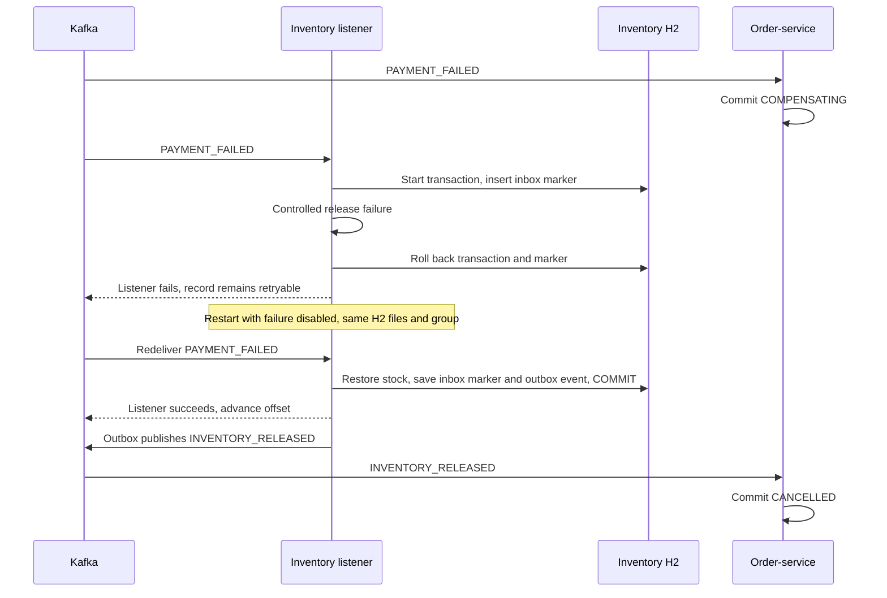

# S018 — Recover unfinished choreography

[Overview](00-distributed-transactions-overview.md) · [Roadmap](../../topics.md#s018) · [Prerequisite: S017](s017_saga_compensation.md) · [Order fault controls](../../order-service/src/main/java/com/tip/ecommerce/s018_saga_recovery/) · [Inventory fault control](../../inventory-service/src/main/java/com/tip/ecommerce/s018_saga_recovery/)

## 1. The story and problem

A customer has an accepted checkout. Payment-service stops before processing it.
Or payment fails and inventory cannot release the book immediately. We need to
continue the original checkout when the service returns, without charging or
restoring stock twice.

This lesson reuses S017's choreography and database tables. The `s018` profile adds
controlled failure and duplicate-publication switches. It does not add a second
checkout implementation.

**At-least-once delivery** means an event can arrive more than once. **Idempotent
processing** means those repeats have the same business effect as one successful
processing. We keep the event ID and the completed business change in one transaction.

## 2. Our implementation

### Keep outgoing work until Kafka acknowledges it

Each service's [EventRepository](../../order-service/src/main/java/com/tip/ecommerce/s017_saga_compensation/EventRepository.java)
saves outgoing JSON in `saga_outbox` within the business transaction. The
[OutboxPublisher](../../order-service/src/main/java/com/tip/ecommerce/s017_saga_compensation/OutboxPublisher.java)
runs once per configured delay:

```java
// Same order ID key; same saved event ID and payload on every attempt.
kafka.send(topic, Long.toString(event.orderId()), event.payload()).get(12, TimeUnit.SECONDS);
// Only mark delivery after the broker acknowledges the send.
events.markSent(event.sequence());
```

If the process stops between these statements, the event may be published again.
A lost acknowledgement also leaves the outcome uncertain. The publisher keeps the
row and retries; it does not conclude that the business step failed.

Producer idempotence helps with Kafka producer retries. It does not eliminate a
second application-level publication after a process restart. The receiver therefore
needs its own protection. See the [transactional outbox pattern](https://microservices.io/patterns/data/transactional-outbox.html).

### Commit the duplicate marker with the local work

Inside each service's transactional event handler:

```java
if (!events.firstDelivery(event.eventId())) return;
// Business updates and any outgoing event happen in this same transaction.
```

The repository inserts a unique `saga_inbox.event_id`. A repeated ID returns false.
If processing throws, that marker rolls back along with the business changes, so
the next attempt is allowed. Reservations and the unique payment `order_id` also
protect business identity.

The listener calls the service through its Spring transaction proxy. After the
service commits, the listener returns and Kafka's RECORD acknowledgement advances
the consumer offset. If the process stops after the database commit but before
that offset is committed, redelivery sees the already committed inbox marker.
This is safe repeated processing, not a single transaction spanning H2 and Kafka.

### Leave failed compensation unfinished

The [inventory failure switch](../../inventory-service/src/main/java/com/tip/ecommerce/s018_saga_recovery/ReleaseFailure.java)
throws before releasing stock. The whole inventory transaction rolls back,
including the inbox marker. Order remains COMPENSATING.

[SagaKafkaConfiguration](../../inventory-service/src/main/java/com/tip/ecommerce/s017_saga_compensation/SagaKafkaConfiguration.java)
configures `DefaultErrorHandler` with a two-second `FixedBackOff` and
`UNLIMITED_ATTEMPTS`. Failed records are retried instead of discarded. The
[Spring Kafka error-handling reference](https://docs.spring.io/spring-kafka/reference/kafka/annotation-error-handling.html)
describes these retry settings.



### Know the boundary of this example

There is one process per service and one Kafka partition. A permanently bad record
blocks later records for that consumer group until repaired. Other service groups
can continue. A larger system needs monitoring of pending work, a repair process,
and a considered dead-letter/replay policy; dropping a failed release is not a fix.

File-backed H2 demonstrates process-restart recovery on this machine. Kafka's single
replica and local H2 files do not demonstrate host-loss resilience. Event retention
must cover expected outages. Outbox and inbox history is retained here; production
cleanup must respect replay and deduplication requirements.

Payment is a local simulator. For a real payment-provider timeout, use a stable
provider idempotency key and query the provider's result before deciding whether to
retry or refund. A missing reply does not prove a charge failed. This implementation
does not call a bank or demonstrate refunds.

## 3. Configuration for the exercises

Reuse all [S017 run settings](s017_saga_compensation.md#complete-run-selections).
Use profiles `s017,s018` for order and inventory; payment uses `s017`. Keep the same
run ID and working directory when restarting a participant. Each independent
scenario below begins with a new run ID in all three applications.

Only these demo overrides vary:

| Application | VM option | Purpose |
| --- | --- | --- |
| Payment | `-Dsaga.demo.payment-result=DECLINE` | Record a payment rejection |
| Inventory | `-Dsaga.demo.fail-release=true` | Fail the compensation transaction before stock restoration |
| Order | `-Dsaga.demo.duplicate-publish=true` | Publish the same saved event twice |

Both S018 switches default to false in the relevant `application-s018.yml` files.
Use only the override named by the exercise. Remove it and restart to restore normal
behavior. The publisher and consumer configurations remain those from S017.

## 4. Evidence to follow

Submit checkout through Postman, then read its order status. Use read-only inventory
and payment requests to inspect the participating databases. Match `orderId` and
`eventId` in service consoles; timestamps and IDs vary.

Local H2 verification confirmed duplicate handling, a rolled-back release attempt,
successful retry, and persisted order/outbox data after restarting the process.
Those checks called the transactional services directly. They did not verify Kafka
redelivery, consumer offsets, or an AWS outage. The exercises below are expected
live results to verify with your existing Kafka connection.

## 5. Testing

### Scenario 1 — Resume an order after payment-service restarts

Prerequisite: fresh run ID `s018-payment`; normal SUCCESS result. Start all services,
wait for Kafka assignment, then stop payment-service in IntelliJ.

```bash
curl --request POST 'http://localhost:9101/s017/api/orders/checkout' \
  --header 'Content-Type: application/json' \
  --header 'Idempotency-Key: payment-outage-1' \
  --data '{"customerId":"customer1","expectedAmount":22.00,"items":[{"sku":"BOOK-1","quantity":1}]}'
curl --request GET 'http://localhost:9101/s017/api/orders/1'
curl --request GET 'http://localhost:9105/api/inventory/reservations/1'
```

POST returns 202. After inventory processes the event, both GETs return 200:

```json
{"orderId":1,"status":"PENDING","reason":null}
```

```json
{"orderId":1,"state":"RESERVED","items":[{"sku":"BOOK-1","quantity":1}]}
```

Restart payment with the **same run ID**. Do not submit another checkout.

```bash
curl --request GET 'http://localhost:9101/s017/api/orders/1'
curl --request GET 'http://localhost:9103/s017/api/payments/orders/1'
```

Eventually HTTP 200 reports:

```json
{"orderId":1,"status":"CONFIRMED","reason":null}
```

```json
{"paymentId":1,"orderId":1,"amount":22.00,"status":"SUCCESS"}
```

Payment's console handles the waiting INVENTORY_RESERVED event. This resumes the
original order. There is no automatic cancellation merely because payment was offline.

### Scenario 2 — Retry compensation after inventory release fails

Prerequisite: fresh run ID `s018-release`. Payment VM option
`-Dsaga.demo.payment-result=DECLINE`; inventory VM option
`-Dsaga.demo.fail-release=true`; inventory profiles `s017,s018`.

```bash
curl --request POST 'http://localhost:9101/s017/api/orders/checkout' \
  --header 'Content-Type: application/json' \
  --header 'Idempotency-Key: release-outage-1' \
  --data '{"customerId":"customer1","expectedAmount":22.00,"items":[{"sku":"BOOK-1","quantity":1}]}'
curl --request GET 'http://localhost:9101/s017/api/orders/1'
curl --request GET 'http://localhost:9105/api/inventory/BOOK-1'
```

POST returns 202. After payment is handled, GETs return 200:

```json
{"orderId":1,"status":"COMPENSATING","reason":"Payment declined"}
```

```json
{"sku":"BOOK-1","available":99}
```

Inventory's console reports `S018 demo: inventory release unavailable` during retries.
Remove the **inventory** failure VM option and restart inventory with the same run
ID. Leave the failed payment record intact.

```bash
curl --request GET 'http://localhost:9101/s017/api/orders/1'
curl --request GET 'http://localhost:9105/api/inventory/reservations/1'
curl --request GET 'http://localhost:9105/api/inventory/BOOK-1'
```

After retry, HTTP 200 bodies are:

```json
{"orderId":1,"status":"CANCELLED","reason":"Payment declined"}
```

```json
{"orderId":1,"state":"RELEASED","items":[{"sku":"BOOK-1","quantity":1}]}
```

```json
{"sku":"BOOK-1","available":100}
```

This retries the earlier failed release, not a new checkout. Restart did not reseed
stock to 100: the compensating transaction restored it. Remove the payment decline
override before the next exercise.

### Scenario 3 — Handle repeated delivery and a repeated checkout

Prerequisite: fresh run ID `s018-duplicate`; payment SUCCESS. Set order profiles
`s017,s018` and VM option `-Dsaga.demo.duplicate-publish=true`.

```bash
curl --request POST 'http://localhost:9101/s017/api/orders/checkout' \
  --header 'Content-Type: application/json' \
  --header 'Idempotency-Key: duplicate-1' \
  --data '{"customerId":"customer1","expectedAmount":22.00,"items":[{"sku":"BOOK-1","quantity":1}]}'
curl --request GET 'http://localhost:9101/s017/api/orders/1'
```

POST returns 202; wait for GET to return HTTP 200 with CONFIRMED. Then repeat checkout:

```bash
curl --request POST 'http://localhost:9101/s017/api/orders/checkout' \
  --header 'Content-Type: application/json' \
  --header 'Idempotency-Key: duplicate-1' \
  --data '{"customerId":"customer1","expectedAmount":22.00,"items":[{"sku":"BOOK-1","quantity":1}]}'
curl --request GET 'http://localhost:9105/api/inventory/BOOK-1'
curl --request GET 'http://localhost:9103/s017/api/payments/orders/1'
```

The repeated POST returns HTTP 202 with the existing result:

```json
{"orderId":1,"status":"CONFIRMED","reason":null}
```

GETs return HTTP 200 with `{"sku":"BOOK-1","available":99}` and
`{"paymentId":1,"orderId":1,"amount":22.00,"status":"SUCCESS"}`.
Inventory's console shows the same ORDER_CREATED event ID handled twice. Its inbox
prevents a second reservation. The checkout key separately prevents a second order.
The payment table's unique order ID prevents a second local payment record.

Now reuse that key for different work:

```bash
curl --request POST 'http://localhost:9101/s017/api/orders/checkout' \
  --header 'Content-Type: application/json' \
  --header 'Idempotency-Key: duplicate-1' \
  --data '{"customerId":"customer1","expectedAmount":44.00,"items":[{"sku":"BOOK-1","quantity":2}]}'
```

Expected HTTP 409 in Postman. Relevant body:

```json
{"status":409,"detail":"Idempotency-Key already used for another checkout"}
```

Remove the duplicate-publication override after this exercise.

### Scenario 4 — Keep checkout when the publisher cannot reach Kafka

Prerequisite: fresh run ID `s018-publish`; normal payment and no failure switches.
First start all three with the working Kafka address so the topic exists. Stop only
order-service. Change its environment to `KAFKA_BOOTSTRAP_SERVERS=localhost:19092`,
using an unused port, then restart it with the same run ID.

KafkaAdmin can log a connection failure during startup. Its configured
`fail-fast: false` lets the application finish startup. Wait for the HTTP server.

```bash
curl --request POST 'http://localhost:9101/s017/api/orders/checkout' \
  --header 'Content-Type: application/json' \
  --header 'Idempotency-Key: broker-outage-1' \
  --data '{"customerId":"customer1","expectedAmount":22.00,"items":[{"sku":"BOOK-1","quantity":1}]}'
curl --request GET 'http://localhost:9101/s017/api/orders/1'
```

POST returns 202. GET returns HTTP 200:

```json
{"orderId":1,"status":"PENDING","reason":null}
```

The order console reports `Event remains pending eventId=... orderId=1 ...`.
The order and its outgoing event are committed even though publication failed.

Restore order-service's Kafka environment to the working address, and restart it
with the same run ID and working directory. Do not repeat checkout.

```bash
curl --request GET 'http://localhost:9101/s017/api/orders/1'
curl --request GET 'http://localhost:9105/api/inventory/BOOK-1'
```

After the saved event is published, HTTP 200 bodies become
`{"orderId":1,"status":"CONFIRMED","reason":null}` and
`{"sku":"BOOK-1","available":99}`. The original pending outbox row drove recovery.
The existing AWS broker was not stopped for this exercise.

## 6. Interview practice

### “What if the service crashes after publishing?”

“If it has not marked the outbox row sent, it may publish again after restart.
We retain the event ID and store an inbox marker with the receiver's business change,
so the duplicate has no second business effect.”

### “What if compensation fails?”

“We leave the order COMPENSATING and retry the failed event. We do not mark it
cancelled until inventory confirms release. The failed attempt rolls back its
inbox marker, so retry is still possible.”

### “Does Kafka exactly-once processing make this whole checkout exactly once?”

“No. Kafka's guarantees do not automatically include our H2 writes or a bank call.
We use local transactions, an outbox, and duplicate checks. A real payment provider
also needs a stable operation key and a way to inspect uncertain results.”

### “What are the trade-offs of this retry policy?”

“It preserves unfinished work, but a permanently bad event can block that group's
partition. I need monitoring and an explicit repair policy. A dead-letter queue
alone does not complete the customer's compensation.”

### “Would you choose choreography for every workflow?”

“No. It fits this small set of reactions. As branches, deadlines, and participants
grow, an orchestrator can make the workflow easier to inspect. Reliable delivery
and idempotent participants are still needed either way.”
