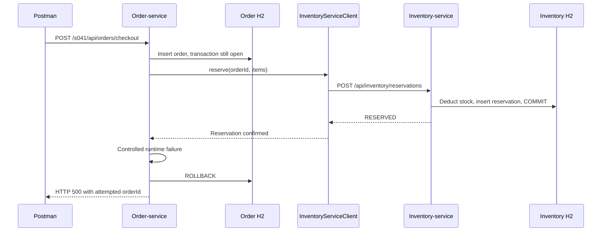

# S041 — Local transaction boundaries

[Overview](00-distributed-transactions-overview.md) · [Roadmap](../../topics.md#s041) · [Order implementation](../../order-service/src/main/java/com/tip/ecommerce/s041_transaction_boundary/) · [Next: choreography](s017_saga_compensation.md)

## 1. The story and problem

A customer checks out one BOOK-1. Order-service writes the order, then asks inventory
to reserve the book. Inventory commits. Before checkout finishes, order-service fails.

> **This scenario demonstrates the limit of a local transaction.**
> Order-service rolls back its order row, but inventory's reservation remains committed
> and available stock stays reduced. The databases are now inconsistent: stock is
> reserved for an order that does not exist. S041 deliberately exposes this problem
> and leaves it unresolved. [S017 — Saga choreography and compensation](s017_saga_compensation.md)
> shows how to keep the order's progress and release reserved stock when payment fails.

## 2. Our implementation

[BoundaryService](../../order-service/src/main/java/com/tip/ecommerce/s041_transaction_boundary/BoundaryService.java)
uses the existing order entity, Spring Data repository, and shared
[InventoryServiceClient](../../order-service/src/main/java/com/tip/ecommerce/client/InventoryServiceClient.java).
This excerpt omits request validation:

```java
@Transactional
public Accepted checkout(Checkout request) {
    // Flush sends SQL to the order DB. The transaction has not committed yet.
    var order = orders.saveAndFlush(new Order(request.customerId(), request.expectedAmount()));
    // Inventory commits in its own process before this call returns successfully.
    inventory.reserve(order.getId(), request.items());
    // This runtime exception rolls back the local order, not inventory's transaction.
    if (failAfterReservation) throw new CheckoutRolledBackException(order.getId());
    return new Accepted(order.getId(), "PENDING", "RESERVED");
}
```

Spring applies the transaction when the controller calls the service bean. The
[exception handler](../../order-service/src/main/java/com/tip/ecommerce/exception/BoundaryExceptionHandler.java)
returns 500 after that call has rolled back. `orderId` identifies the attempted order;
it is not proof that an order row still exists.



## 3. Configure IntelliJ

Use Java 17 and reload the Maven projects. The existing order POM provides
`spring-boot-starter-data-jpa` and H2; inventory uses `spring-boot-starter-jdbc` and
H2. These supply local transaction support. The annotation activates the boundary
around the service method. No extra transaction library is needed for S041.

Stop any other copies of these applications first. Start:

| Order | Main class | Active profiles | VM options |
| --- | --- | --- | --- |
| 1 | `com.tip.ecommerce.InventoryServiceApplication` | empty | empty |
| 2 | `com.tip.ecommerce.OrderServiceApplication` | `s041` | empty |

Use the existing module classpath for each run configuration. No Kafka or telemetry
agent is needed for this lesson. Clear old `s017` environment/profile selections.
The normal `application.yml` files provide ports 9105 and 9101, the inventory URL,
and separate in-memory H2 databases. Inventory's `data.sql` seeds BOOK-1 with 100.

[application-s041.yml](../../order-service/src/main/resources/application-s041.yml)
provides the controlled failure:

```yaml
s041:
  fail-after-reservation: true
```

## 4. Demonstrate the boundary

Import the requests below into Postman. Restart **both** applications before each
independent testing scenario to reset their in-memory databases together.
Observe the response in Postman and `reservation.committed` in the inventory console.

The rollback example was run locally: HTTP 500, `orderExists=false`, and BOOK-1
stock 99 were observed. Successful checkout and the unavailable-inventory case
were also verified locally. IDs below describe a fresh database; later IDs can differ.
The diagram and source explain why those three facts belong together.

## 5. Testing

### Scenario 1 — Roll back the order after inventory commits

Prerequisite: fresh applications and the default `s041` failure setting.

```bash
curl --request POST 'http://localhost:9101/s041/api/orders/checkout' \
  --header 'Content-Type: application/json' \
  --data '{"customerId":"customer1","expectedAmount":22.00,"items":[{"sku":"BOOK-1","quantity":1}]}'
```

Expected HTTP 500. Sample response:

```json
{"type":"about:blank","title":"Internal Server Error","status":500,"detail":"Demo failure after inventory committed; local order rolled back","instance":"/s041/api/orders/checkout","orderId":1}
```

| Field | Explanation |
| --- | --- |
| `orderId` | Generated by the order DB before rollback; added by our exception handler |
| `detail` | Our handler describes the controlled failure |
| `type`, `title`, `status`, `instance` | Spring's ProblemDetail response supplies standard problem fields and the request path |

Inspect the order and stock through these read-only requests. The inventory read
is evidence for this lesson; checkout itself made the reservation request.

```bash
curl --request GET 'http://localhost:9101/s041/api/orders/1'
curl --request GET 'http://localhost:9105/api/inventory/BOOK-1'
```

Both return HTTP 200. Sample bodies, in request order:

```json
{"orderId":1,"orderExists":false}
```

```json
{"sku":"BOOK-1","available":99}
```

Inventory's console shows the committed reservation for order 1. A rolled-back
identity value need not be reused, so the next order ID can be 2.

### Scenario 2 — Finish checkout without the controlled failure

Prerequisite: restart both applications. Add this VM option to order-service:

```text
-Ds041.fail-after-reservation=false
```

This overrides the lesson's failure setting; the database and URL settings still
come from `application.yml`.

```bash
curl --request POST 'http://localhost:9101/s041/api/orders/checkout' \
  --header 'Content-Type: application/json' \
  --data '{"customerId":"customer1","expectedAmount":22.00,"items":[{"sku":"BOOK-1","quantity":1}]}'
```

Expected HTTP 202:

```json
{"orderId":1,"status":"PENDING","state":"RESERVED"}
```

```bash
curl --request GET 'http://localhost:9101/s041/api/orders/1'
curl --request GET 'http://localhost:9105/api/inventory/BOOK-1'
```

Expected HTTP 200 with `{"orderId":1,"orderExists":true}` and
`{"sku":"BOOK-1","available":99}`. This proves a new checkout can finish. It does
not repair an earlier failed checkout. Remove the VM override after this scenario.

### Scenario 3 — Inventory is unavailable before reservation

Prerequisite: restart both applications, then stop inventory-service. Order keeps
profile `s041`. This request fails before reaching the controlled post-reservation failure.

```bash
curl --request POST 'http://localhost:9101/s041/api/orders/checkout' \
  --header 'Content-Type: application/json' \
  --data '{"customerId":"customer1","expectedAmount":22.00,"items":[{"sku":"BOOK-1","quantity":1}]}'
```

Expected HTTP 503 in Postman. Relevant response fields:

```json
{"status":503,"detail":"Inventory reservation failed","orderId":1}
```

The shared exception handler logs `inventory.failed` in the order console.

```bash
curl --request GET 'http://localhost:9101/s041/api/orders/1'
```

Expected HTTP 200: `{"orderId":1,"orderExists":false}`. Restart inventory and follow
Scenario 2 to submit a new successful request. There is no retry of the earlier
checkout. A connection refusal in this exercise occurs before delivery; a timeout
in a running system does not by itself prove that inventory did nothing.

## 6. Interview practice

### “Why did `@Transactional` not restore stock?”

“It managed the order database transaction. Inventory ran in another process and
committed independently. Rolling back order-service did not undo that commit.”

### “Does flushing mean the order committed?”

“No. Flush sends pending SQL to the database. The transaction can still roll back.
Our demo flushed the order, then failed, and the row was absent afterwards.”

### “How would you fix the partial checkout?”

“I would model the steps and their failure outcomes. In our next lesson, payment
failure triggers a new inventory transaction that releases the stock. We persist
unfinished work so that compensation can be retried.”
