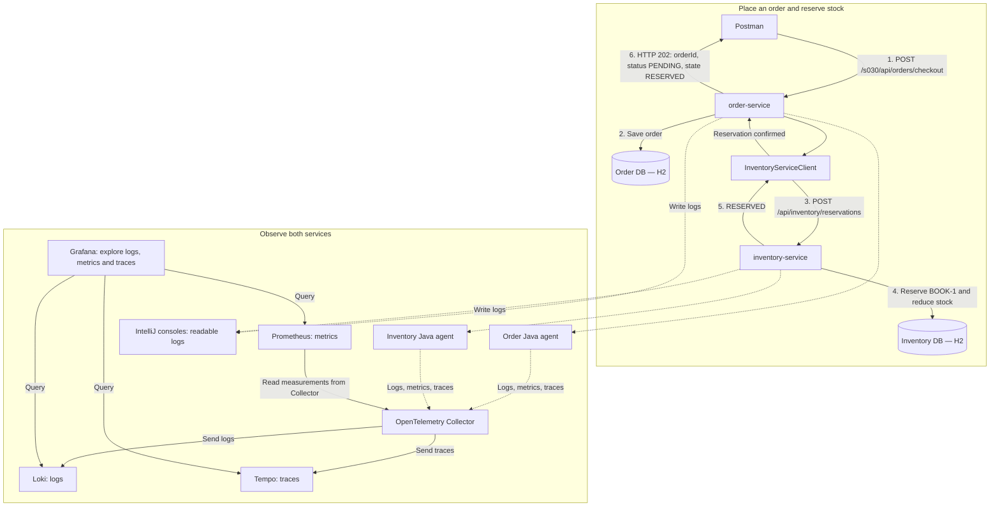

# Observability — follow an order through inventory

[Workspace](../../README.md) · [Roadmap](../../topics.md#s030)

## A customer places an order

A customer orders one copy of BOOK-1. Order-service saves the order and directly
asks inventory-service to reserve the book. Inventory records the reservation and
reduces available stock in the inventory DB (`inventory-service-db`).

Sometimes that reservation succeeds quickly. Sometimes it is slow or fails.
**Observability means understanding a running system from the information it produces.**

| Signal | Meaning | Question |
| --- | --- | --- |
| Logs | Messages about individual events | Did this order reach inventory, and what happened? |
| Metrics | Measurements over time | How many reservations arrived, and how long did they take? |
| Traces | Connected, timed steps of an operation | Was time spent in the inventory call or its database work? |

## Follow the order

The numbered steps show a successful checkout. Order-service waits for inventory to
reserve stock before returning the response. If the inventory call fails, the shared
exception handler records an ERROR log and returns HTTP 503.

Both services write readable text logs to their IntelliJ consoles. Each service's Java agent
also sends logs, metrics, and traces to the Collector. Loki stores the logs, Tempo
stores the traces, and Prometheus reads measurements from the Collector. Grafana
uses these three sources to help investigate a failed or slow reservation.

## Learning path

| Order | Lesson | Question |
| --- | --- | --- |
| 1 | [S030 — Logging: follow an order into inventory](s030_logging.md) | What happened to this order? |
| 2 | [S031, Part A — Metrics: measure inventory reservations](s031_metrics_traces.md#metrics) | How are reservation requests behaving? |
| 3 | [S031, Part B — Traces: locate the slow step](s031_metrics_traces.md#traces) | Where did the inventory call spend time? |
| Later | [S032 — Investigate a slow inventory reservation](s032_incident_diagnosis.md) | What evidence explains the delay and recovery? |

## Interview practice

### “What is observability?”

“Observability helps us understand what is happening inside our application and find
out why something is slow or failing. For example, if placing an order takes too long,
logs tell me what happened, metrics show how often it happens and how long requests take,
and traces show which step took the time—such as the call to inventory-service.”

### “What does each tool do?”

“The Java agents send signals to the Collector. Loki stores logs, Tempo stores traces,
and Prometheus collects metrics. Grafana lets me investigate them together.”

### “Does observability fix a problem?”

“It helps me locate and explain the cause. After fixing that cause, I repeat the
operation and compare the new evidence to check recovery.”
